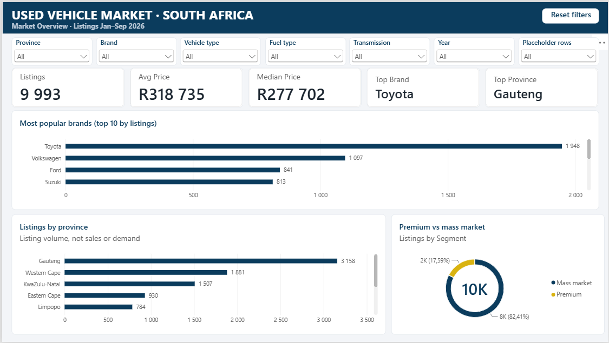
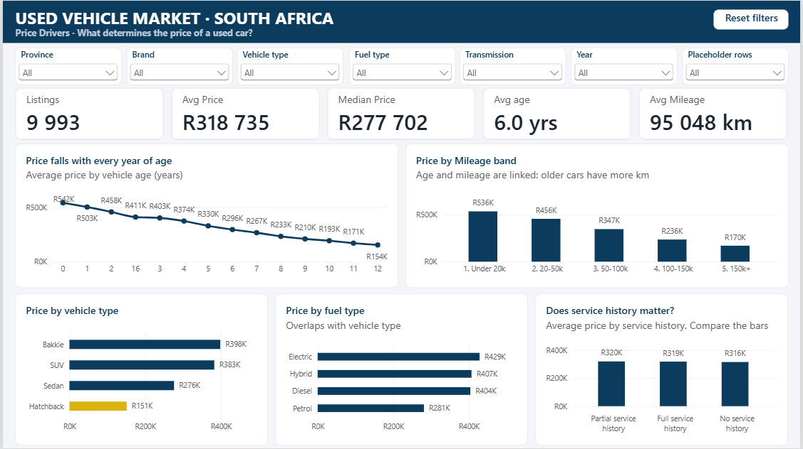
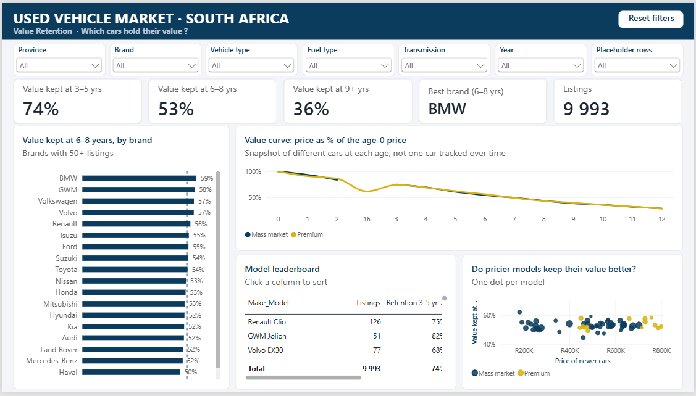
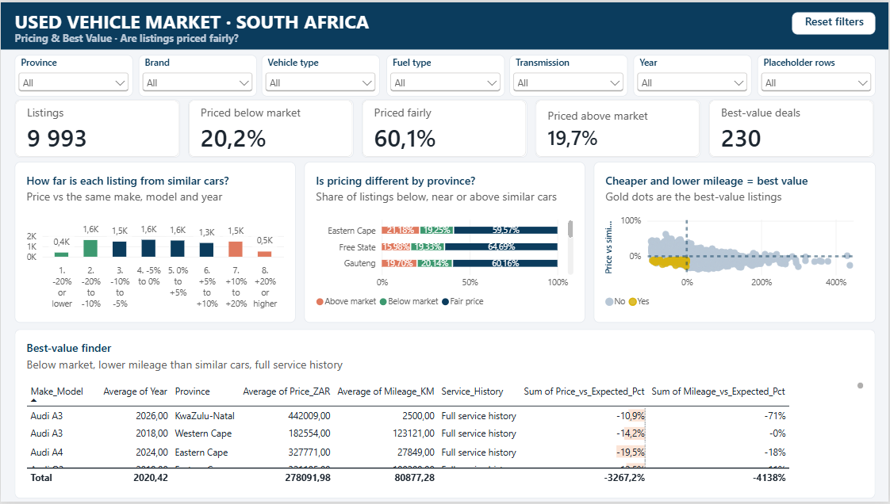

# South African Used Vehicle Market: Pricing, Value Retention and Best Value

A four-page Power BI dashboard, built on about 10,000 used-car listings, that answers one question:

> **What determines the price of a used car in South Africa, and which vehicles offer the best value?**

**Tools:** Python (pandas) · Power Query · Power BI · DAX
**Skills shown:** data cleaning, data modelling, DAX, pricing analysis, dashboard design, business storytelling

---

## Dashboard preview

| Market Overview | Price Drivers |
|---|---|
|  |  |

| Value Retention | Pricing & Best Value |
|---|---|
|  |  |


---

## Business questions

Imagine working for a used-car marketplace. Management wants to know:

1. Which brands are most popular?
2. Which cars retain their value?
3. What factors drive vehicle prices?
4. Which provinces have the highest demand?
5. Are listings priced competitively?
6. Which vehicles provide the best value for customers?

---

## Key findings

| Question | Finding |
|---|---|
| **Popular brands** | Toyota leads with 19.5% of listings, followed by Volkswagen (11.0%) and Ford (8.4%) |
| **Value retention** | Cars keep about 74% of their value at 3-5 years, 53% at 6-8 years and 36% at 9+ years. Premium and mass-market brands depreciate at almost the same rate |
| **Price drivers** | Make, model and age explain about 95% of price variation. Mileage adds about 2 points. Transmission, service history, previous owners, province and colour add essentially nothing |
| **Provinces** | Gauteng, Western Cape and KwaZulu-Natal hold about 65% of listings (measured by listing volume, not true demand) |
| **Pricing** | 60% of listings are priced fairly, 20% are 10%+ below comparable cars and 20% are 10%+ above |
| **Best value** | 230 listings are priced at least 10% below comparable cars, have lower-than-average mileage and full service history |

The full write-up is in [`PROJECT_SUMMARY.md`](PROJECT_SUMMARY.md).

---

## Recommendations

Based on the analysis of 9,992 used-vehicle listings, the following recommendations highlight opportunities for improving inventory planning, pricing strategies and purchasing decisions within the South African used-vehicle market.

### 1. Optimise Inventory Planning Around Leading Vehicle Brands

Toyota, Volkswagen and Ford account for approximately 39% of all listings, with Toyota representing the largest share at 19.5%.

**Recommendation:** Dealerships should consider prioritising these brands when planning inventory acquisition and marketing strategies, as they represent a significant portion of the available market. However, stock allocation should also be guided by sales performance, profit margins and inventory turnover to ensure that high listing volumes translate into viable business opportunities.

### 2. Incorporate Vehicle Age and Depreciation into Purchasing Decisions

Vehicles retain approximately 74% of their value after 3–5 years, 53% after 6–8 years and 36% after nine or more years. The analysis also indicates broadly similar depreciation patterns between premium and mass-market vehicles.

**Recommendation:** Buyers and dealerships should pay particular attention to vehicle age when evaluating purchase prices and potential resale value. Vehicles within the 3–5-year range may offer a favourable balance between depreciation and remaining value. Businesses should also avoid assuming that premium vehicles necessarily provide better value retention.

### 3. Adopt Data-Driven Vehicle Pricing Strategies

Make, model and age account for approximately 95% of price variation, increasing to approximately 97% when mileage is included.

**Recommendation:** Dealerships and online marketplaces should incorporate these factors into their pricing strategies by benchmarking vehicles against comparable listings. This would help sellers establish more competitive asking prices, reduce pricing inconsistencies and enable buyers to make better-informed purchasing decisions.

### 4. Introduce Market-Based Pricing Indicators

Approximately 60% of listings are priced within 10% of comparable vehicles, while 20% are at least 10% below and another 20% are at least 10% above the benchmark.

**Recommendation:** Online marketplaces should consider introducing comparative pricing indicators to help buyers and sellers evaluate listing prices against similar vehicles. Listings priced significantly above the benchmark could be flagged for review, while competitively priced listings could receive additional visibility. This would improve pricing transparency and help customers identify potentially attractive purchasing opportunities.

### 5. Develop a Best-Value Vehicle Identification Strategy

The analysis identified 230 listings that were priced at least 10% below comparable vehicles, had below-average or average mileage relative to their comparison group, and included a full service history.

**Recommendation:** Marketplaces should consider introducing a best-value vehicle category that highlights listings combining competitive prices, reasonable mileage and documented service history. This could simplify vehicle comparisons, improve the customer purchasing experience and help buyers identify potentially worthwhile deals. However, vehicle condition and history should still be independently verified before purchase.

### Overall Recommendation

Used-car businesses should strengthen their decision-making processes through data-driven inventory planning, competitive pricing and vehicle evaluation. The findings demonstrate the value of using vehicle characteristics and comparable market listings to identify pricing opportunities and support more informed purchasing decisions. Incorporating actual sales data, customer enquiries and vehicle condition information in future analysis would further improve the reliability and commercial relevance of these recommendations.

---

## Dashboard pages

| Page | Question it answers | Main visuals |
|---|---|---|
| **1. Market Overview** | Which brands and provinces dominate? | KPI cards, top-10 brands, listings by province, premium vs mass-market split |
| **2. Price Drivers** | What determines price? | Price by vehicle age, mileage band, vehicle type, fuel type and service history |
| **3. Value Retention** | Which cars hold their value? | Retention by brand, value curve (premium vs mass market), model leaderboard, price vs retention scatter |
| **4. Pricing & Best Value** | Are listings priced fairly, and which are the best deals? | Price-gap distribution, pricing by province, price vs mileage scatter, best-value finder |

All pages share the same filters (province, brand, vehicle type, fuel, transmission, year and a placeholder-row toggle), synchronised across pages, plus a reset button.

---

## Data

**File:** `data/raw/SA_Used_Vehicle_Market_RAW.csv`, 10,025 rows and 16 columns, listings from January to September 2026.
**Data Source:** AI-generated synthetic dataset developed to simulate the South African used-vehicle market for educational and analytical purposes.

| Column | Description |
|---|---|
| Vehicle_ID | Unique listing ID |
| Brand, Model, Vehicle_Type | Make, model and body type (SUV, Hatchback, Bakkie, Sedan) |
| Year | Model year |
| Price_ZAR | Asking price in rand |
| Mileage_KM | Odometer reading |
| Fuel_Type, Transmission, Engine_Size_L | Petrol/Diesel/Hybrid/Electric, Automatic/Manual, engine size in litres |
| Province, City | Location |
| Listing_Date | Date listed |
| Colour, Previous_Owners, Service_History | Other listing attributes |

### Data cleaning

Cleaning is done in `clean_data.py` and logged in the output workbook's `Cleaning_Log` sheet.

| Issue found | Action | Rows |
|---|---|---|
| Duplicate listings | Removed | 25 |
| Impossible or outlier years (1900, 2010, 2035, 2050) | Removed (valid range 2014-2026) | 4 |
| Impossible prices (R5,000 and R25,000; R4.5M and R9,999,999) | Removed | 4 |
| Impossible mileage (negative, zero, above 500,000 km) | Set to blank | 4 |
| 63 spellings of 20 brands, plus mixed case in Province, Fuel_Type and Transmission | Trimmed and standardised | all |
| Engine size 0.0 L on electric vehicles | Set to blank so averages are not distorted | 116 |
| Blank City, Colour and Service_History | Filled with "Unknown" | 110 / 50 / 70 |
| Suspicious repeated values: exactly 2,500 km (459 rows) and exactly R59,900 (37 rows) | **Kept and flagged** with `Placeholder_Flag`, so results can be tested with and without them | 494 |

**Result:** 10,025 raw rows became **9,992 clean rows** with 22 columns.

---

## Data model

A simple star schema in Power BI:

```
Dim_Brand (Brand, Segment)  1 ───────< *  Fact_Vehicles
```

- **Fact_Vehicles:** one row per listing.
- **Dim_Brand:** maps each of the 20 brands to a segment (Premium: BMW, Mercedes-Benz, Audi, Volvo, Land Rover; Mass market: the rest).

### Calculated columns (examples)

```DAX
-- Average price of cars with the same make, model and year
Expected_Price =
CALCULATE(
    AVERAGE(Fact_Vehicles[Price_ZAR]),
    ALLEXCEPT(Fact_Vehicles, Fact_Vehicles[Make_Model], Fact_Vehicles[Year])
)

Price_vs_Expected_Pct =
DIVIDE(Fact_Vehicles[Price_ZAR] - Fact_Vehicles[Expected_Price], Fact_Vehicles[Expected_Price])

-- Cheap, lower mileage than peers, enough peers to compare, full service history
Best_Value =
IF(
    Fact_Vehicles[Price_vs_Expected_Pct] <= -0.10
        && NOT ISBLANK(Fact_Vehicles[Mileage_vs_Expected_Pct])
        && Fact_Vehicles[Mileage_vs_Expected_Pct] <= 0
        && Fact_Vehicles[Group_Count] >= 5
        && Fact_Vehicles[Service_History] = "Full service history",
    "Yes", "No"
)
```

### Measures (examples)

```DAX
Retention 6-8 yr % =
DIVIDE(
    CALCULATE([Median Price], Fact_Vehicles[Age_Band] = "6-8 yrs"),
    CALCULATE([Median Price], Fact_Vehicles[Age_Band] = "0-2 yrs")
)

Price Index =
VAR BasePrice =
    CALCULATE([Avg Price],
        REMOVEFILTERS(Fact_Vehicles[Vehicle_Age]),
        REMOVEFILTERS(Fact_Vehicles[Age_Band]),
        Fact_Vehicles[Vehicle_Age] = 0)
RETURN DIVIDE([Avg Price], BasePrice)
```

Other measures include `Listings`, `Avg Price`, `Median Price`, `Below Market %`, `Fair Price %`, `Above Market %`, `Best Value Deals`, `Top Brand` and `Top Province`.

---

## Method notes

- **Value retention** compares the median price of 3-5, 6-8 and 9+ year-old cars with the median price of 0-2 year-old cars. It is a snapshot of different cars at different ages, not the tracked depreciation of individual cars.
- **Price benchmark ("expected price")** is the average price of cars with the same make, model and year in this dataset. It is not an official valuation guide.
- **Best value** requires a price at least 10% below benchmark *and* mileage at or below average, because cheaper listings are often just higher-mileage cars (correlation of about -0.4 between price gap and mileage gap).
- **Price drivers** were checked with a simple regression on log price. Age alone explains about 48% of variation, model alone about 49% and the two together about 95%.

---


## AI Usage and Acknowledgement

AI tools were used throughout this project as supportive resources to improve productivity, assist with problem-solving and strengthen the overall analytical workflow.

AI assistance was primarily used for:
- **Research and Brainstorming:** Exploring potential business questions, identifying relevant analytical approaches and generating ideas for investigating the used-vehicle market.
- **Technical Assistance:** Supporting Python, SQL and Power BI development through explanations, troubleshooting and guidance on analytical techniques.
- **Data Analysis:** Exploring possible interpretations of analytical findings and identifying additional perspectives to consider.
- **Documentation:** Improving the structure, clarity and presentation of project documentation, including the README and business recommendations.

**Responsible AI Use:** AI-generated suggestions and outputs were reviewed, evaluated and adapted throughout the project. Final analytical decisions, validation of findings, interpretation of results and project direction remained my responsibility.

AI was used as an assistance tool rather than a replacement for independent analysis, critical thinking or technical understanding.

---

## Repository structure

```
.
├── README.md
├── PROJECT_SUMMARY.md          # Written findings
├── clean_data.py               # Reproducible cleaning script
├── data/
│   ├── raw/SA_Used_Vehicle_Market_RAW.csv
│   └── clean/SA_Used_Vehicle_Market_CLEAN.xlsx
├── powerbi/
│   ├── SA_Used_Vehicles.pbix
│   └── SA_UsedCars_Theme.json  # Custom colour theme
└── images/                     # Dashboard screenshots
```

---

## How to reproduce

1. Clone the repository.
2. Install dependencies: `pip install pandas numpy openpyxl`
3. Run `python clean_data.py` from the repository root. It reads the raw CSV and writes the clean workbook.
4. Open `powerbi/SA_Used_Vehicles.pbix` in Power BI Desktop. If prompted, point the data source to `data/clean/SA_Used_Vehicle_Market_CLEAN.xlsx`.
5. To use the custom theme in a new report: **View → Themes → Browse for themes** and select `SA_UsedCars_Theme.json`.

The report also applies a report-level filter on `Year ≥ 2014`. The script already applies the same rule, so the numbers match.

---

## Limitations

- There is **no seller type** in the data, so dealers cannot be separated from private sellers.
- There is **no demand measure** (views, enquiries, days to sell), so listing volume is used as a proxy.
- There is **no original price**, so retention is a cross-section of the market.
- Age and mileage are correlated, so their separate effects are hard to untangle.
- Condition, accident history and trim level are not in the data.
- Some findings, such as service history having no effect on price, differ from what is commonly reported in the market. Validate them on live listing data before generalising.

## Possible next steps

- Build a price-prediction model (for example, gradient boosting) and compare its predictions with the benchmark used here.
- Add a "fair price" calculator page where users enter make, model, year and mileage.
- Track listings over time to measure real depreciation and days to sell.

---

## Author

**Kharendwe** · Johannesburg, South Africa
GitHub: [@Kharendwenegota](https://github.com/Kharendwenegota)

LinkedIn: [@Kharendwenegota](https://linkedin.com/in/kharendwe-negota)

Email: [kharendwenegota3@gmail.com](mailto:kharendwenegota3@gmail.com)
