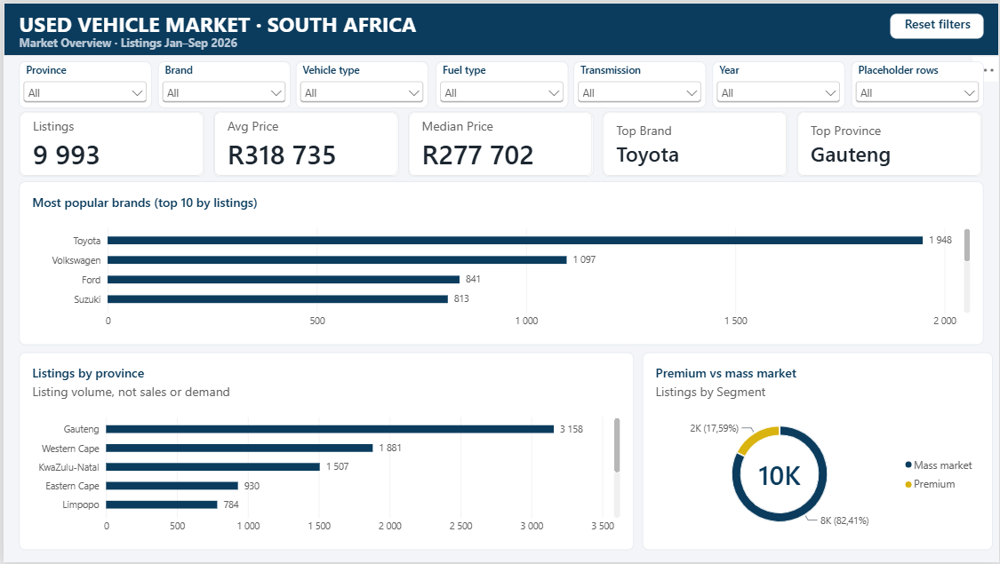
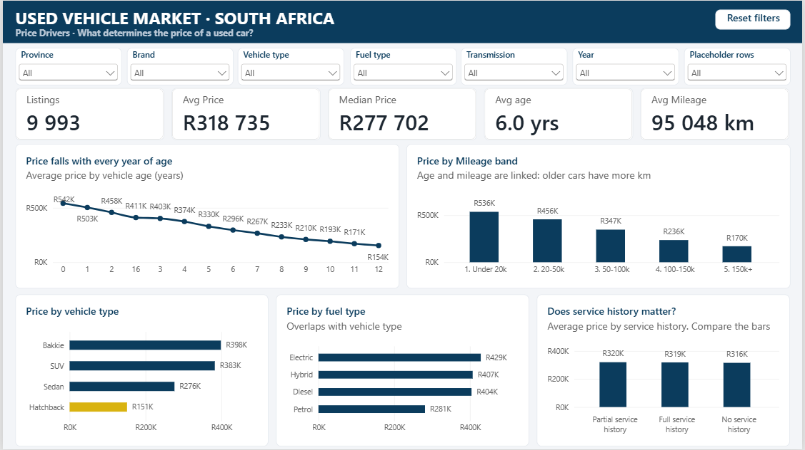
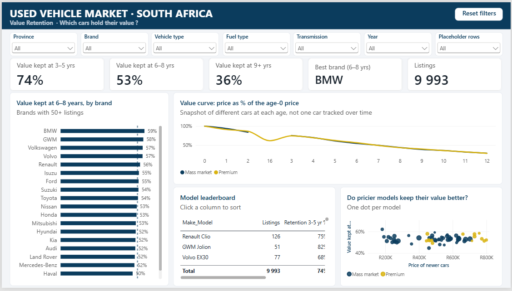
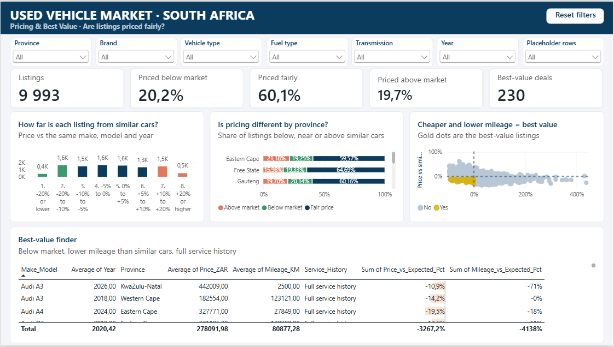

# South African Used Vehicle Market: Pricing, Value Retention and Best Value

A four-page Power BI dashboard, built on about 10,000 used-car listings, that answers one question:

> **What determines the price of a used car in South Africa, and which vehicles offer the best value?**

**Tools:** Python (pandas) · Power Query · Power BI · DAX
**Skills shown:** data cleaning, data modelling, DAX, pricing analysis, dashboard design, business storytelling

---

## Dashboard preview

| Market Overview | Price Drivers |
|---|---|
|  |  |

| Value Retention | Pricing & Best Value |
|---|---|
|  |  |

> Add your screenshots to an `images/` folder using these file names.

---

## Business questions

Imagine working for a used-car marketplace. Management wants to know:

1. Which brands are most popular?
2. Which cars retain their value?
3. What factors drive vehicle prices?
4. Which provinces have the highest demand?
5. Are listings priced competitively?
6. Which vehicles provide the best value for customers?

---

## Key findings

| Question | Finding |
|---|---|
| **Popular brands** | Toyota leads with 19.5% of listings, followed by Volkswagen (11.0%) and Ford (8.4%) |
| **Value retention** | Cars keep about 74% of their value at 3-5 years, 53% at 6-8 years and 36% at 9+ years. Premium and mass-market brands depreciate at almost the same rate |
| **Price drivers** | Make, model and age explain about 95% of price variation. Mileage adds about 2 points. Transmission, service history, previous owners, province and colour add essentially nothing |
| **Provinces** | Gauteng, Western Cape and KwaZulu-Natal hold about 65% of listings (measured by listing volume, not true demand) |
| **Pricing** | 60% of listings are priced fairly, 20% are 10%+ below comparable cars and 20% are 10%+ above |
| **Best value** | 230 listings are priced at least 10% below comparable cars, have lower-than-average mileage and full service history |

The full write-up is in [`PROJECT_SUMMARY.md`](PROJECT_SUMMARY.md).

---

## Dashboard pages

| Page | Question it answers | Main visuals |
|---|---|---|
| **1. Market Overview** | Which brands and provinces dominate? | KPI cards, top-10 brands, listings by province, premium vs mass-market split |
| **2. Price Drivers** | What determines price? | Price by vehicle age, mileage band, vehicle type, fuel type and service history |
| **3. Value Retention** | Which cars hold their value? | Retention by brand, value curve (premium vs mass market), model leaderboard, price vs retention scatter |
| **4. Pricing & Best Value** | Are listings priced fairly, and which are the best deals? | Price-gap distribution, pricing by province, price vs mileage scatter, best-value finder |

All pages share the same filters (province, brand, vehicle type, fuel, transmission, year and a placeholder-row toggle), synchronised across pages, plus a reset button.

---

## Data

**File:** `data/raw/SA_Used_Vehicle_Market_RAW.csv`, 10,025 rows and 16 columns, listings from January to September 2026.
**Source:** IA generated for educational experiences 

| Column | Description |
|---|---|
| Vehicle_ID | Unique listing ID |
| Brand, Model, Vehicle_Type | Make, model and body type (SUV, Hatchback, Bakkie, Sedan) |
| Year | Model year |
| Price_ZAR | Asking price in rand |
| Mileage_KM | Odometer reading |
| Fuel_Type, Transmission, Engine_Size_L | Petrol/Diesel/Hybrid/Electric, Automatic/Manual, engine size in litres |
| Province, City | Location |
| Listing_Date | Date listed |
| Colour, Previous_Owners, Service_History | Other listing attributes |

### Data cleaning

Cleaning is done in `clean_data.py` and logged in the output workbook's `Cleaning_Log` sheet.

| Issue found | Action | Rows |
|---|---|---|
| Duplicate listings | Removed | 25 |
| Impossible or outlier years (1900, 2010, 2035, 2050) | Removed (valid range 2014-2026) | 4 |
| Impossible prices (R5,000 and R25,000; R4.5M and R9,999,999) | Removed | 4 |
| Impossible mileage (negative, zero, above 500,000 km) | Set to blank | 4 |
| 63 spellings of 20 brands, plus mixed case in Province, Fuel_Type and Transmission | Trimmed and standardised | all |
| Engine size 0.0 L on electric vehicles | Set to blank so averages are not distorted | 116 |
| Blank City, Colour and Service_History | Filled with "Unknown" | 110 / 50 / 70 |
| Suspicious repeated values: exactly 2,500 km (459 rows) and exactly R59,900 (37 rows) | **Kept and flagged** with `Placeholder_Flag`, so results can be tested with and without them | 494 |

**Result:** 10,025 raw rows became **9,992 clean rows** with 22 columns.

---

## Data model

A simple star schema in Power BI:

```
Dim_Brand (Brand, Segment)  1 ───────< *  Fact_Vehicles
```

- **Fact_Vehicles:** one row per listing.
- **Dim_Brand:** maps each of the 20 brands to a segment (Premium: BMW, Mercedes-Benz, Audi, Volvo, Land Rover; Mass market: the rest).

### Calculated columns (examples)

```DAX
-- Average price of cars with the same make, model and year
Expected_Price =
CALCULATE(
    AVERAGE(Fact_Vehicles[Price_ZAR]),
    ALLEXCEPT(Fact_Vehicles, Fact_Vehicles[Make_Model], Fact_Vehicles[Year])
)

Price_vs_Expected_Pct =
DIVIDE(Fact_Vehicles[Price_ZAR] - Fact_Vehicles[Expected_Price], Fact_Vehicles[Expected_Price])

-- Cheap, lower mileage than peers, enough peers to compare, full service history
Best_Value =
IF(
    Fact_Vehicles[Price_vs_Expected_Pct] <= -0.10
        && NOT ISBLANK(Fact_Vehicles[Mileage_vs_Expected_Pct])
        && Fact_Vehicles[Mileage_vs_Expected_Pct] <= 0
        && Fact_Vehicles[Group_Count] >= 5
        && Fact_Vehicles[Service_History] = "Full service history",
    "Yes", "No"
)
```

### Measures (examples)

```DAX
Retention 6-8 yr % =
DIVIDE(
    CALCULATE([Median Price], Fact_Vehicles[Age_Band] = "6-8 yrs"),
    CALCULATE([Median Price], Fact_Vehicles[Age_Band] = "0-2 yrs")
)

Price Index =
VAR BasePrice =
    CALCULATE([Avg Price],
        REMOVEFILTERS(Fact_Vehicles[Vehicle_Age]),
        REMOVEFILTERS(Fact_Vehicles[Age_Band]),
        Fact_Vehicles[Vehicle_Age] = 0)
RETURN DIVIDE([Avg Price], BasePrice)
```

Other measures include `Listings`, `Avg Price`, `Median Price`, `Below Market %`, `Fair Price %`, `Above Market %`, `Best Value Deals`, `Top Brand` and `Top Province`.

---

## Method notes

- **Value retention** compares the median price of 3-5, 6-8 and 9+ year-old cars with the median price of 0-2 year-old cars. It is a snapshot of different cars at different ages, not the tracked depreciation of individual cars.
- **Price benchmark ("expected price")** is the average price of cars with the same make, model and year in this dataset. It is not an official valuation guide.
- **Best value** requires a price at least 10% below benchmark *and* mileage at or below average, because cheaper listings are often just higher-mileage cars (correlation of about -0.4 between price gap and mileage gap).
- **Price drivers** were checked with a simple regression on log price. Age alone explains about 48% of variation, model alone about 49% and the two together about 95%.

---

## Repository structure

```
.
├── README.md
├── PROJECT_SUMMARY.md          # Written findings
├── clean_data.py               # Reproducible cleaning script
├── data/
│   ├── raw/SA_Used_Vehicle_Market_RAW.csv
│   └── clean/SA_Used_Vehicle_Market_CLEAN.xlsx
├── powerbi/
│   ├── SA_Used_Vehicles.pbix
│   └── SA_UsedCars_Theme.json  # Custom colour theme
└── images/                     # Dashboard screenshots
```

---

## How to reproduce

1. Clone the repository.
2. Install dependencies: `pip install pandas numpy openpyxl`
3. Run `python clean_data.py` from the repository root. It reads the raw CSV and writes the clean workbook.
4. Open `powerbi/SA_Used_Vehicles.pbix` in Power BI Desktop. If prompted, point the data source to `data/clean/SA_Used_Vehicle_Market_CLEAN.xlsx`.
5. To use the custom theme in a new report: **View → Themes → Browse for themes** and select `SA_UsedCars_Theme.json`.

The report also applies a report-level filter on `Year ≥ 2014`. The script already applies the same rule, so the numbers match.

---

## Limitations

- There is **no seller type** in the data, so dealers cannot be separated from private sellers.
- There is **no demand measure** (views, enquiries, days to sell), so listing volume is used as a proxy.
- There is **no original price**, so retention is a cross-section of the market.
- Age and mileage are correlated, so their separate effects are hard to untangle.
- Condition, accident history and trim level are not in the data.
- Some findings, such as service history having no effect on price, differ from what is commonly reported in the market. Validate them on live listing data before generalising.

## Possible next steps

- Build a price-prediction model (for example, gradient boosting) and compare its predictions with the benchmark used here.
- Add a "fair price" calculator page where users enter make, model, year and mileage.
- Track listings over time to measure real depreciation and days to sell.

---

## Author

**Kharendwe** · Johannesburg, South Africa
GitHub: [@Kharendwenegota](https://github.com/Kharendwenegota)

LinkedIn: [@Kharendwenegota](https://linkedin.com/in/kharendwe-negota)

Email: [kharendwenegota3@gmail.com](mailto:kharendwenegota3@gmail.com)
